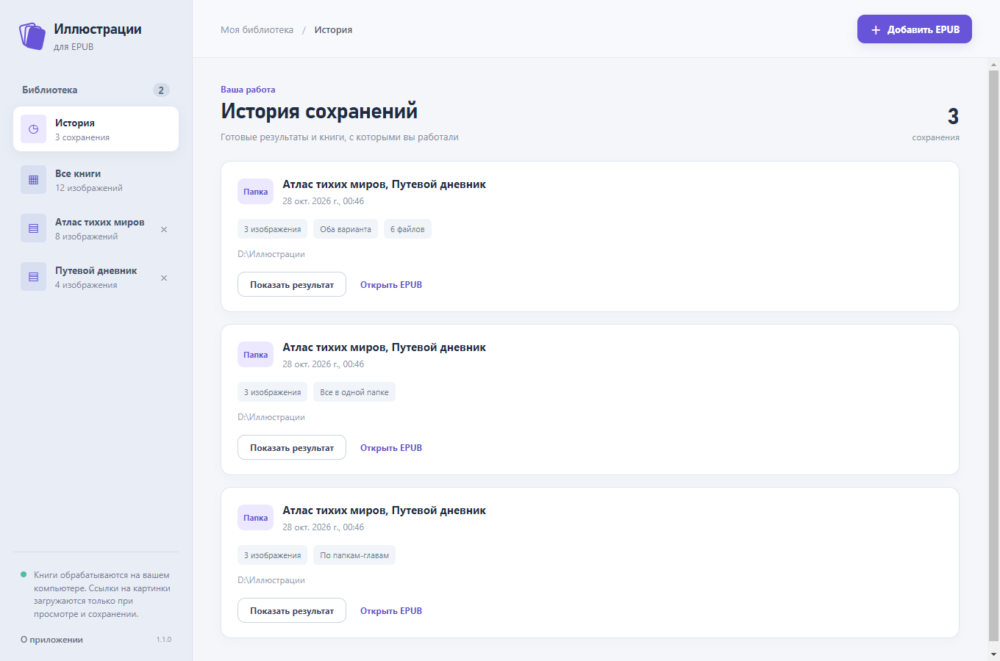
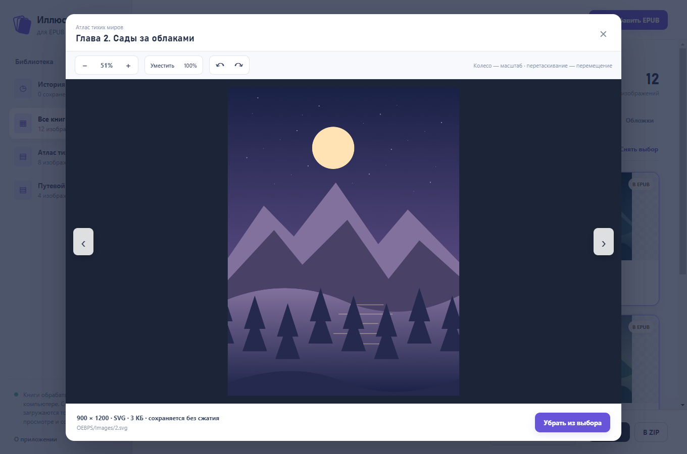

<div align="center">


# Иллюстрации EPUB

**Из книги — в вашу коллекцию.**

Иллюстрации по главам: посмотреть, выбрать, сохранить в папку или ZIP.

[](https://github.com/aleksandreev2/EpubIllustrations/releases/latest)
[](#установка)
[](https://github.com/aleksandreev2/EpubIllustrations/actions/workflows/ci.yml)
[](LICENSE)

**[Скачать для Windows](https://github.com/aleksandreev2/EpubIllustrations/releases/latest)** ·
[Руководство](docs/guide.md) · [История версий](CHANGELOG.md) ·
[Сообщить об ошибке](https://github.com/aleksandreev2/EpubIllustrations/issues/new/choose)

</div>

**Иллюстрации EPUB** — настольное приложение команды **Дом Некроманта**.
Добавьте одну или несколько книг, просмотрите картинки по главам и отметьте
нужные. Приложение найдёт изображения внутри EPUB и прямые ссылки на них,
включая ссылки NovelPia с окончанием `.file`.


## Установка

1. Откройте [последний релиз](https://github.com/aleksandreev2/EpubIllustrations/releases/latest).
2. Скачайте **`EpubIllustrations-1.1.0-Setup.exe`** из раздела **Assets**.
3. Запустите установщик и откройте **«Иллюстрации EPUB»** через ярлык.

Для запуска без установки скачайте **`EpubIllustrations-1.1.0-Portable.exe`**.
Оба варианта содержат всё необходимое; Node.js и Python пользователю не нужны.
Поддерживаются **Windows 10 и 11, 64 бит**.

Архивы **Source code** на GitHub предназначены для разработчиков.
Для обычного использования выберите файл **Setup.exe** или **Portable.exe**.

## Сохранить иллюстрации за минуту

1. Нажмите **«Добавить EPUB»** или перетащите книги в окно.
2. Выберите книгу слева. Откройте картинку, чтобы рассмотреть её ближе.
3. Отметьте нужные изображения. Иллюстрации глав выбраны автоматически,
   обложки можно добавить отдельно.
4. При необходимости измените папку вывода, затем нажмите **«В папку»** или **«В ZIP»**.

```text
Атлас тихих миров/
  0003 Глава 2. Сады за облаками/
    001.svg
```

Книги и главы получают отдельные папки. Исходные EPUB приложение не меняет;
при повторном сохранении в папку существующие изображения сохраняются,
а новые одноимённые файлы получают номер в скобках.

## Возможности

| Возможность | Что делает |
| --- | --- |
| Несколько книг | Принимает EPUB кнопкой или перетаскиванием, показывает общую галерею и каждую книгу отдельно |
| Постоянная библиотека | Восстанавливает книги и выбранные иллюстрации после закрытия приложения |
| История | Запоминает завершённые сохранения и позволяет открыть результат или снова загрузить EPUB |
| Картинки внутри EPUB | Извлекает JPG, PNG, WebP, GIF, AVIF, BMP и SVG |
| Изображения по ссылкам | Загружает прямые HTTPS-ссылки на картинки, в том числе `images.novelpia.com/…ori.file` |
| Привязка к главам | Читает порядок EPUB и сохраняет название главы рядом с иллюстрацией |
| Отбор | Поиск по главе и книге, фильтры источников, выбор отдельных или всех видимых картинок |
| Просмотрщик | Масштаб колесом, перемещение мышью, поворот на 90°, перелистывание и режим 100% |
| Без пережатия | Сохраняет исходные байты, показывает разрешение, формат и размер изображения |
| Папка или ZIP | Три структуры: по главам, в одной папке для каждой книги, оба варианта одновременно |
| Обложки | Показывает их отдельно и по умолчанию не включает в выбор |
| Обновления | Уведомляет о новых версиях, скачивает и проверяет обновление перед запуском |

## Как организовать результат

Внизу окна выберите структуру. Она применяется одинаково к папке и ZIP;
при добавлении нескольких книг у каждой остаётся своя папка.

| Режим | Результат |
| --- | --- |
| По папкам-главам | `Книга/0003 Название главы/001.webp` |
| Все в одной папке | `Книга/0003 Название главы - 001.webp` |
| Оба варианта | Две полные копии: `Книга/По главам/…` и `Книга/Все иллюстрации/…` |

## Библиотека помнит вашу работу

Книги, выбор иллюстраций и последний режим экспорта восстанавливаются после
перезапуска. Раздел **«История»** хранит завершённые сохранения: дату, книги,
структуру, число изображений и путь. **«Показать результат»** открывает папку
или расположение ZIP, **«Открыть EPUB»** возвращает книги в галерею.



Если исходный EPUB перемещён, запись остаётся в библиотеке: нажмите
**«Найти EPUB»**, чтобы указать новый путь. Удаление книги из списка не удаляет
историю её сохранений и не затрагивает файлы.

## Рассмотреть каждую деталь

Колесо мыши меняет масштаб, перетаскивание двигает изображение, кнопки
поворачивают его и перелистывают галерею. **«100%»** показывает исходный
размер в пикселях, **«Уместить»** возвращает картинку в границы окна.



Все скриншоты сделаны в работающем приложении с
[демонстрационными книгами](examples/README.md). Иллюстрации для примеров
созданы специально для проекта.

## Вопросы и ответы

<details>
<summary><strong>Ухудшается ли качество при сохранении?</strong></summary>

Нет. Встроенные изображения копируются из EPUB байт в байт, а файлы по ссылкам
сохраняются без повторного сжатия. Если картинка в книге уже маленькая или сильно
сжата, извлечение не восстановит утраченные детали. Разрешение, формат и размер
исходника показаны под большим предпросмотром.

</details>

<details>
<summary><strong>Нужен ли интернет? Куда отправляются книги?</strong></summary>

Встроенные картинки извлекаются локально и доступны без интернета. Для картинок
по ссылкам приложение обращается к адресу соответствующего изображения при
предпросмотре или сохранении. Сами книги и тексты глав никуда не загружаются.
Для проверки новых версий приложение обращается к GitHub Releases. В нём нет
аналитики и автоматической отправки книг.

</details>

<details>
<summary><strong>Это загрузчик книг с NovelPia?</strong></summary>

Приложение работает с EPUB, которые вы добавили, и с прямыми ссылками на картинки
внутри этих EPUB. Адрес страницы романа не заменяет сам файл книги. Вход на сайты,
получение закрытых глав и обход DRM не поддерживаются.

</details>

<details>
<summary><strong>Почему по ссылке не удалось загрузить картинку?</strong></summary>

Ссылка могла устареть, сервер может требовать авторизацию или быть недоступен.
Приложение показывает ошибку; после сохранения остальных картинок в уведомлении
видны число ошибок и первая из них. Поддерживаются публичные
HTTPS-ссылки, а не страницы с формой входа.

</details>

## Обновления в приложении

С версии **1.1.0** приложение проверяет стабильные релизы GitHub при запуске
и каждые шесть часов, пока открыто. Если появилась новая версия, в окне
появится уведомление с кнопками **«Что нового»** и **«Обновить»**. Когда окно
неактивно, поддерживаемые системы также показывают уведомление Windows.

Нажмите **«Обновить»** и подтвердите обновление.
После скачивания приложение проверит размер и SHA-256 файла, затем закроется.
У установленной версии откроется установщик; переносимая версия заменит свой EXE
и запустится снова. Библиотека, история, выбор иллюстраций, папка вывода
и настройки сохранятся.

Ручная проверка и переключатель **«Проверять автоматически»** находятся
в **«О приложении → Обновления»**. Кнопка скрытия уведомления отключает напоминание
об этой версии; ручная проверка снова показывает её.

**Для перехода с 1.0.0 один раз скачайте 1.1.0 из
[релизов](https://github.com/aleksandreev2/EpubIllustrations/releases/latest).**
После этого следующие версии можно будет получать из приложения.

## Для разработчиков

Нужен **Node.js 22.4 или новее**. Для сборки Windows-дистрибутива используйте Windows.

```bash
git clone https://github.com/aleksandreev2/EpubIllustrations.git
cd EpubIllustrations
npm ci
npm start
```

```bash
npm test              # проверки EPUB, экспорта и геометрии просмотрщика
npm run demo          # демонстрационные EPUB
npm run screenshots   # реальные снимки интерфейса с демоматериалами
npm run dist          # установщик и переносимый EXE в dist/
npm run checksums     # SHA-256 для файлов релиза
```

Архитектура, сборка и публикация описаны в
[документации для разработчиков](docs/development.md).
Правила участия — в [CONTRIBUTING.md](CONTRIBUTING.md).

## Лицензия и авторство

Код распространяется под [лицензией MIT](LICENSE).
Electron и остальные библиотеки сохраняют собственные лицензии —
см. [сведения о сторонних компонентах](THIRD_PARTY_NOTICES.md).

Разработчик — **[dollar](https://ranobelib.me/ru/user/726236)**,
команда **[Дом Некроманта](https://ranobelib.me/ru/team/11969--dom-nekromanta)**.

<details>
<summary><strong>Об авторе в приложении</strong></summary>


</details>
