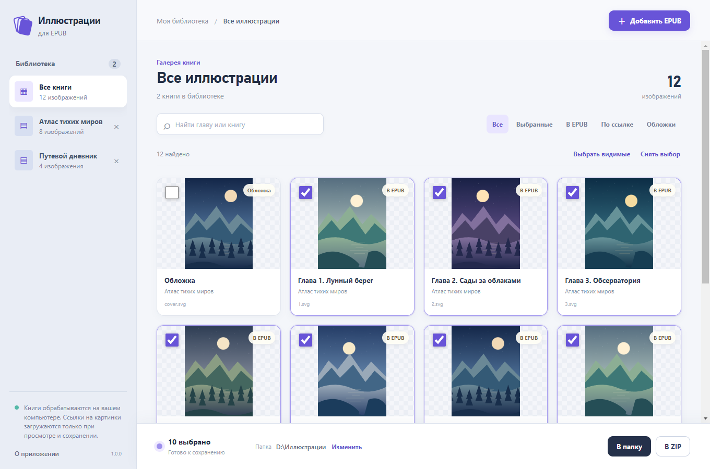

# Руководство

[Скачать приложение](https://github.com/aleksandreev2/EpubIllustrations/releases/latest) · [На главную](../README.md)

## Добавить книги

Нажмите **«Добавить EPUB»** и выберите один или несколько файлов. Можно также
перетащить их из Проводника в окно. Список книг находится слева; **«Все книги»**
возвращает общую галерею. Крестик убирает книгу из текущего списка приложения,
не удаляя исходный файл.



## Найти и выбрать картинки

Введите название главы или книги в поиск. Фильтры позволяют оставить выбранные
изображения, картинки внутри EPUB, изображения по ссылкам или обложки.

Флажок на картинке включает её в экспорт. **«Выбрать видимые»** отмечает текущий
результат поиска и фильтров, **«Снять выбор»** очищает весь выбор. Обложки по
умолчанию не отмечаются; их можно сохранить вручную.

## Большой предпросмотр

Нажмите на изображение. Внизу видны его исходное разрешение, формат и размер,
а также путь внутри EPUB или адрес прямой ссылки.

| Действие | Мышь или клавиша |
| --- | --- |
| Приблизить и отдалить | Колесо мыши; кнопки `+` и `−`; клавиши `+` и `-` |
| Переместить картинку | Удерживать левую кнопку и перетаскивать |
| Уместить в окно | Кнопка «Уместить» или клавиша `0` |
| Исходный размер | Кнопка «100%» |
| Переключить исходный размер и размещение в окне | Двойной щелчок по изображению |
| Повернуть на 90° | Кнопки поворота; клавиша `R` поворачивает вправо |
| Предыдущая и следующая | Кнопки по краям изображения или стрелки влево/вправо |
| Закрыть | Крестик или `Esc` |

Изображения перелистываются в порядке текущей галереи. Масштаб и поворот
относятся к просмотру; в экспорт попадает исходный файл.

## Сохранить в папку

Внизу окна отображается выбранная папка. Нажмите **«Изменить»**, чтобы выбрать
другую; приложение запомнит её. **«В папку»** сохраняет отмеченные изображения
в подпапки книг и глав. Повторяющиеся имена получают суффикс `(2)`, `(3)` и далее.

Папка по умолчанию: `Рабочий стол/вытянуть иллюстрации новелпиа`.

```text
Название книги/
  0000 Обложка/
    001.jpg
  0003 Название главы/
    001.webp
    002.png
  9999 Вне глав/
    001.svg
```

Число в имени папки соответствует порядку документа внутри EPUB. Титульные
страницы и служебные документы тоже могут занимать позиции, поэтому оно может
отличаться от номера главы в её заголовке. Изображения без привязки к тексту
попадают в **«Вне глав»**.

## Сохранить ZIP

Нажмите **«В ZIP»**, выберите имя и место для архива. Структура внутри будет
такой же, как при сохранении в папку. Готовый ZIP можно распаковать средствами
Windows. Кнопка **«Показать результат»** в уведомлении открывает его расположение.

## Качество и ссылки

Приложение сохраняет исходные байты. Перевод WEBP в PNG сам по себе не вернул бы
детали, потерянные до создания EPUB, поэтому приложение не перекодирует картинки.

Для ссылок NovelPia с расширением `.file` формат определяется по содержимому:
сохранённый файл получит `.png`, `.jpg`, `.webp` или другое подходящее расширение.
Недоступные ссылки отмечаются ошибкой, остальные изображения сохраняются.
После неудачной загрузки повторный предпросмотр или экспорт обращается к ссылке заново.

## Авторство и помощь

Внизу слева откройте **«О приложении»**, чтобы увидеть версию, автора и ссылки.
Разработчик — [dollar](https://ranobelib.me/ru/user/726236), команда
[Дом Некроманта](https://ranobelib.me/ru/team/11969--dom-nekromanta).

Ошибки и предложения принимаются в
[Issues](https://github.com/aleksandreev2/EpubIllustrations/issues/new/choose).
